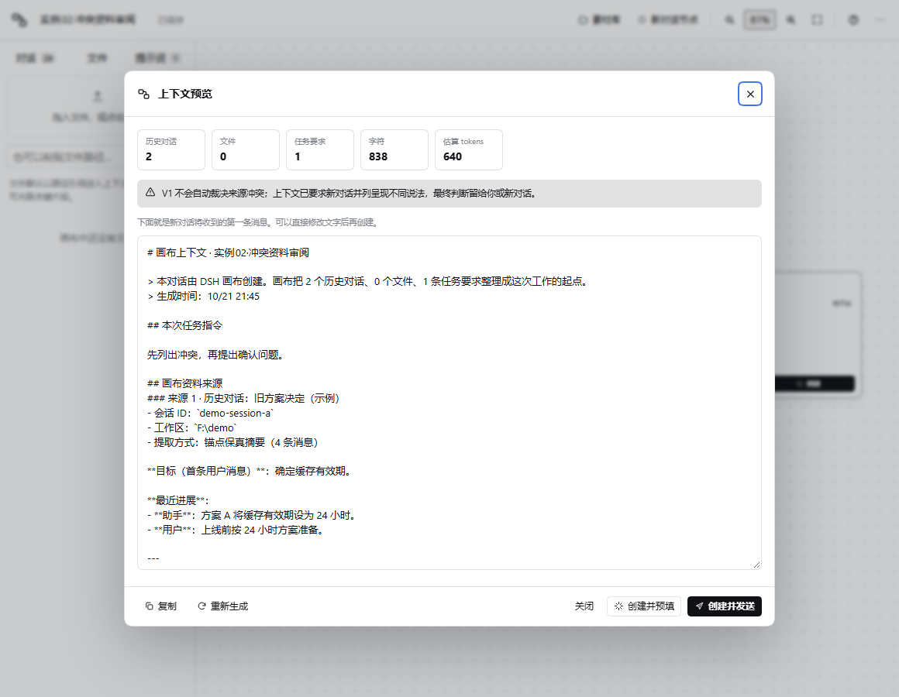

# 操作测试结果 · DSH Context Canvas V1

- 执行日期：2026-10-20
- 执行对象：[OPERATION-REPORT.md](OPERATION-REPORT.md)
- DSH：0.2.1-rc.2（desktop profile）
- 浏览器：Microsoft Edge 155.0.4283.62（headless + CDP）
- 主视口：1440×900；窄视口抽查：754×487
- 测试 profile：`canvas-test`（复制 desktop 的 bundle 列表，共用同一 DSH_HOME）
- 测试主机：`dsh --profile canvas-test --no-open --port 51890`

## 按报告 `9 的提交格式

本轮测试日期：2026-10-20
DSH 版本：0.2.1-rc.2
测试窗口尺寸：1440×900（窄视口抽查 754×487）

T1 正常多来源：通过（修复反馈项后）
T2 冲突资料：通过（修复说明项后）
T3 长文本与引用：通过
T4 导入清洗：通过（修复视口与反馈后）
持久化回归：通过

最严重的三个问题（修复前）：

1. 异常 viewport 导入后缩放 250%，布局不可用；
2. 导入清洗结果不可见，用户不知道哪些节点/连线被丢弃；
3. 禁用来源和冲突场景缺少明确反馈。

希望下一版优先改进：

1. 结构化记忆与冲突候选：在编译前给出可审阅的决定/冲突列表；
2. 未知类型、失效来源的语义处理：不要归一化成空会话节点；
3. 文件快照/哈希、schema 迁移和多画布。

附件：[冲突预览](screenshots/conflict-review.png)；导出 JSON 已在持久化回归中验证，未单独附文件。

## 结果总览

| 测试 | 修复前 | 修复后 | 说明 |
| --- | --- | --- | --- |
| T1 正常多来源 | 部分通过 | 通过（主干回归） | 功能正确；缺少「已禁用来源」统计 |
| T2 冲突资料 | 部分通过 | 通过 | 冲突保留正确；预览缺少「不自动裁决」提示 |
| T3 长文本与引用 | 通过 | 通过 | 截断、围栏、读取、统计均正常 |
| T4 导入清洗 | 部分通过 | 通过 | 清洗正确；视口异常和清理结果不可见 |
| 持久化回归 | 通过 | 通过 | 名称、位置、连线、缩放、导出均恢复 |

## T1 · 正常多来源编排

**修复前实际现象**

- 导入 `01-product-review.json`：5 个节点、4 条连线，名称 `实例01·产品评审上下文`。
- 预览统计：2 个历史对话、1 个文件、1 条任务要求；字符 1,237；估算 912 tokens。
- 来源顺序为产品需求、技术方案、context-spec.md、任务要求；文件在 `text` 围栏中。
- 禁用「技术方案评估」后再次预览：正文中该来源消失，对话数降为 1，字符降为 963。
- 把任务要求上移三次后：来源编号变为 1 任务要求、2 产品、3 技术、4 文件。
- 在预览末尾追加 `[TEST-MARKER-001]` 后创建并预填：composer 文本 1,365 字符，末尾包含该标记。
- 返回画布：chat 节点显示「已创建」和「打开对话」，`resultSessionId` 已写入。
- **差异**：预览没有显示「已禁用 1 个来源」，与报告预期不符。

**修复**

- 预览统计新增「已禁用」卡片（仅当数量 > 0 时显示）。
- 增加 info 提示：「有 N 个来源已禁用，不会进入上下文。」

**修复后**

- T4 的禁用来源场景已验证：统计显示「已禁用 1」，并出现提示。
- T1 主干（多来源、顺序、编辑预览、创建预填）此前已通过，未重复跑完整 15 步。

## T2 · 冲突资料审阅

**实际现象**

- 导入 `02-conflict-review.json`：2 个历史对话、1 条任务要求，字符 782。
- 预览同时包含「24 小时」和「2 小时」两种主张。
- 禁用「最新方案决定」后：只剩 24 小时方案，对话数 1、字符 580。
- 重新启用并上移到第一位：来源编号变为 1 最新方案、2 旧方案、3 任务要求。
- 工作约定包含「不要静默选择其中一个」。
- **差异**：画布/预览没有明确告诉用户「本版没有自动冲突检测」，与报告重点观察不符。

**修复**

- 当来源中历史对话 ≥ 2 时，预览显示 info 提示：「V1 不会自动裁决来源冲突；上下文已要求新对话并列呈现不同说法，最终判断留给你或新对话。」

**修复后**

- 同一场景复测：两条冲突内容都在，提示正常出现，未自动裁决。

## T3 · 长文本与路径引用

**实际现象**

- 导入 `03-long-and-reference.json`：2 个文件节点、1 条任务要求。
- 预览统计：0 个对话、2 个文件、1 条要求；字符 16,722；估算 14,978 tokens。
- 路径引用块 335 字符，只含路径和 `@"..."` 提示，不含正文。
- 超长内联块 16,129 字符，在约 16,000 字符处截断为「…」，`text` 围栏完整闭合。
- 将路径引用节点改为「内联文本」并读取文件后：第一块变为 432 字符的真实 Markdown，统计升到 16,820 字符 / 15,086 tokens。
- 预览没有卡死，代码围栏、按钮和滚动正常。
- 没有发现截断破坏 Markdown 或围栏。

**结论**

T3 通过，无需修改。已知限制仍然是：文件读取取 DSH 预览接口首屏，超长内联在 16k 字符附近截断。

## T4 · 导入清洗和异常数据

**修复前实际现象**

- 导入 `04-import-sanitize.json` 不崩溃。
- 4 个节点：`valid-chat`、`duplicate`（第一份）、`unknown`（归一化为 conversation）、`empty-prompt`。
- 2 条连线：重复连线去重、缺失端点丢弃、自连线丢弃、禁用连线保留。
- 空提示词节点保留，但不进入上下文。
- 视口结果：`x:48, y:0, scale:2.5`，加载后缩放 250%，节点巨大。
- Toast 只显示「画布已导入，共 4 个节点」，没有说明丢弃/归一化了什么。
- 预览：0 对话、0 文件、1 条任务要求；只包含第一份「保留第一份。」，不包含第二份和未知节点。
- **差异**：
  1. `y:null` 被当成 0，而不是默认值 48；
  2. 异常 scale 99 被 clamp 到 2.5，虽然合法，但导入后不可用；
  3. 用户看不到清洗明细。

**修复**

- 视口字段改为严格类型判断：`null`/字符串不再被 `Number()` 转成 0。
- 导入时检测非法视口（非数字、越界、非有限值）：重置为 `48,48,1`，渲染后自动适应视图。
- 导入 Toast 增加清理摘要，例如：
  `已导入 4 个节点、2 条连线；清理：1 个重复节点、1 个未知类型、3 条无效连线、视口已修正`
- 导入 Toast 展示时间延长到 7 秒。

**修复后**

- 导入后缩放 96%，4 个节点、2 条连线可见。
- Toast 显示完整清理摘要。
- 预览仍为 0/0/1，字符 395，禁用统计为 1。

## 持久化回归

- 重命名画布为「持久化回归-测试」，拖动 `duplicate` 节点，适应视图后刷新。
- 刷新后：名称、视口 `x/y/scale`、4 个节点坐标、2 条连线、48% 缩放全部恢复。
- 导出 JSON：`持久化回归-测试.json`，4 个节点、2 条连线、名称和视口完整。
- 没有发现刷新丢结构或导出损坏。

## 发现的问题与优先级

| 优先级 | 问题 | 状态 |
| --- | --- | --- |
| 高 | 导入异常视口导致 250% 巨幅布局 | 已修复：重置并自动 fit |
| 高 | 导入清洗结果不可见 | 已修复：Toast 明细 |
| 中 | 禁用来源没有数量反馈 | 已修复：统计卡片 + 提示 |
| 中 | 冲突场景没有「不自动裁决」说明 | 已修复：预览 info 提示 |
| 中 | 窄窗口下 Tab 标签换行 | 已修复：nowrap + 隐藏 badge |
| 低 | `y:null` 回退成 0 | 已修复：严格类型判断 |
| 低 | 未知类型归一化为空会话的历史对话节点，语义模糊 | 未改；建议后续改为「无效来源」节点或丢弃并提示 |
| 低 | 预览字符数与 textarea 长度偶发差 1 | 未改；由截断/换行导致，不影响使用 |
| 低 | 空提示词节点保留但不进入上下文 | 保持现状；导入报告会说明节点数 |

## 本轮修改的文件

- `src/model.js`：严格视口归一化。
- `src/ui-page.js`：导入清洗摘要、非法视口重置与自动 fit、Toast 时长。
- `src/ui-inspector.js`：已禁用来源统计、禁用提示、冲突提示。
- `src/styles.css`：窄窗口 Tab 不换行、隐藏 badge。
- 重新生成 `client.js`，并做 `node --check`。

## 仍需说明的边界

- 「创建并发送」依赖可用模型；本轮仍只验证「创建并预填」。
- 自动冲突检测、结构化记忆、来源哈希尚未实现。
- 未知节点类型的语义处理仍是 V1.1 的候选优化。
- 导入导出的 schema 版本目前固定为 1，没有迁移器。
