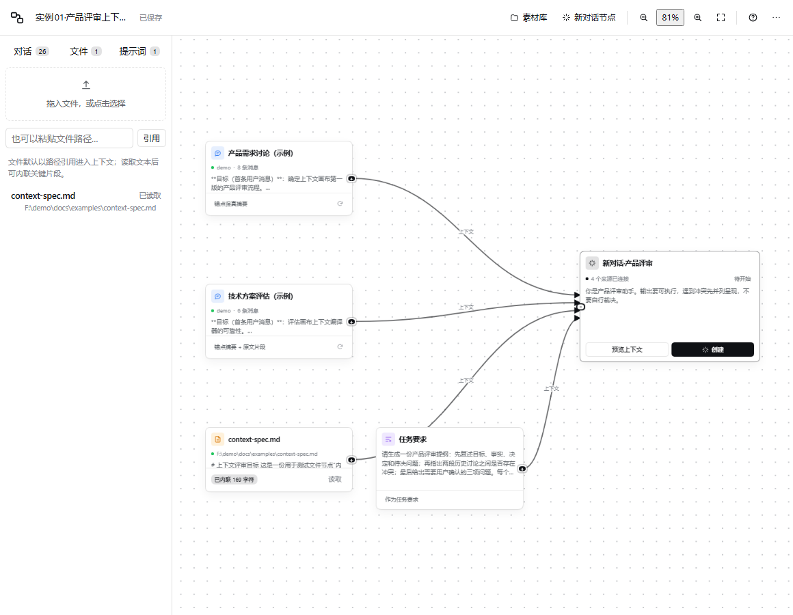
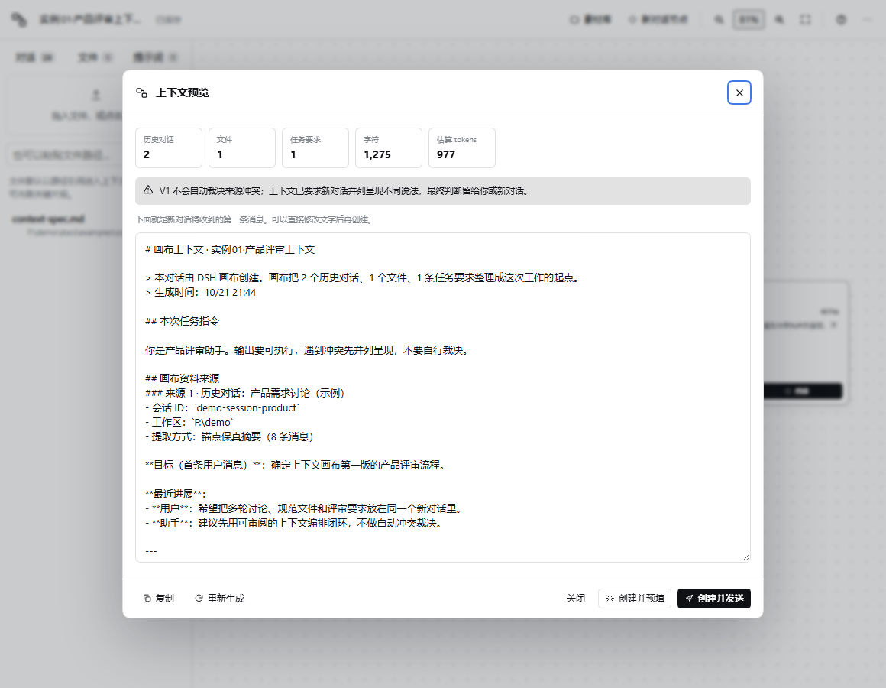

# 验证记录 · DSH Context Canvas V1

- 日期：2026-10-20
- DSH：0.2.1-rc.2（desktop profile）
- 浏览器：Microsoft Edge 155.0.4283.62（headless，CDP）
- 测试视口：1440×900；另有一次 754×487 的窄视口检查
- 测试 profile：`canvas-test`（复制 desktop profile 的 bundle 列表，使用同一 DSH_HOME）
- 测试主机：`dsh --profile canvas-test --no-open --port 51889`

> 说明：桌面端 profile 由 Electron 独占管理，不能直接跑 `dsh` 命令；因此用一个临时 profile 做可重复的 UI 验证。桌面端 host 的启动清单另行确认。
>
> 后续按 [OPERATION-REPORT.md](OPERATION-REPORT.md) 执行的操作测试、发现和优化见 [OPERATION-RESULTS.md](OPERATION-RESULTS.md)。

## 1. 加载与入口

| # | 检查 | 结果 |
| --- | --- | --- |
| 1 | `dsh --profile canvas-test --dump-config` 包含 `dsh-context-canvas` 行 | 通过 |
| 2 | 启动页的 `__DSH_BOOT__` 包含 `dsh-context-canvas/client.js` | 通过 |
| 3 | 桌面端 host 的 Code Cache 出现 `dsh-context-canvas/client.js`（combo 批次） | 通过，说明桌面端实际请求了模块 |
| 4 | 侧边栏出现「画布」，位置在「自动化任务」下面 | 通过（order: 20） |
| 5 | 点击「画布」打开面板，标题、素材库、空状态正常 | 通过 |

## 2. 会话节点与摘要

| # | 检查 | 结果 |
| --- | --- | --- |
| 6 | 点击素材库会话「制作鹈鹕骑自行车动画」加入画布 | 通过；自动创建「新对话」节点 |
| 7 | 节点显示标题、工作区、消息数、摘要 | 通过；sessionId 正确 |
| 8 | 摘要包含首条用户消息作为目标，过滤 runtime context | 通过；过滤后 1 条有效消息 |
| 9 | 刷新摘要、切换「摘要 / 摘要 + 片段 / 完整文本」 | 未逐项回归（切换会清空摘要并自动重取） |

## 3. 连线

| # | 检查 | 结果 |
| --- | --- | --- |
| 10 | 从对话节点右侧圆点拖到「新对话」节点 | 通过；边数 +1，chat 显示「1 个来源已连接」 |
| 11 | 从文件节点拖到同一个 chat 节点 | 通过；chat 显示「2 个来源已连接」 |
| 12 | 在空白处松开自动创建 chat 并连接 | 未单独回归（代码路径存在） |

## 4. 文件

| # | 检查 | 结果 |
| --- | --- | --- |
| 13 | 文件 tab 输入绝对路径 `<workspace>\pelican-bicycle.html`，点「引用」 | 通过；文件节点出现，路径正确 |
| 14 | 点「读取」 | 第一次失败：`offset must be a safe integer of at least 1`；将 offset 从 0 改为 1 后通过 |
| 15 | 读取后节点显示 HTML 预览 | 通过；内容已缓存 |
| 16 | 预览中文件以 `text` 代码块内联 | 通过；上下文包含 `<!DOCTYPE html>` |

## 5. 上下文预览

| # | 检查 | 结果 |
| --- | --- | --- |
| 17 | 点击 chat 节点「预览上下文」 | 通过；弹窗显示统计和完整文本 |
| 18 | 统计：1 个对话、1 个文件、0 条任务要求 | 通过 |
| 19 | 字符 16,664；估算 tokens 5,188 | 通过 |
| 20 | 来源编号、session ID、路径、提取方式、工作约定 | 通过 |
| 21 | 文本可编辑，编辑后用于创建 | 代码支持；未逐字回归 |

## 6. 创建并预填

| # | 检查 | 结果 |
| --- | --- | --- |
| 22 | 点击「创建并预填」 | 通过；会话创建并打开 |
| 23 | 新会话 composer 中出现上下文 | 通过；contenteditable 长度 587 |
| 24 | 页面导航到新会话，画布不残留 modal | 通过 |
| 25 | 回到画布，chat 节点显示「已创建」和「打开对话」 | 通过（结果已写入 localStorage） |

## 7. 持久化与布局

| # | 检查 | 结果 |
| --- | --- | --- |
| 26 | 页面刷新后节点、连线、缩放恢复 | 通过 |
| 27 | 拖动节点，320ms 后 localStorage 坐标更新 | 通过 |
| 28 | 添加 4 个节点（对话/文件/提示词/chat），无重叠 | 通过（findFreeSpot 螺旋避让） |
| 29 | 适应视图 | 通过；测试中曾因把 onClick 事件传给 minScale 出现 NaN，已修复并加类型判断 |
| 30 | 素材库显示/隐藏，画布宽度从 596 → 848 | 通过（React 提交有延迟，需等待一帧读取） |

## 8. 修复记录

| 问题 | 原因 | 修复 |
| --- | --- | --- |
| 加入会话后 sessionId 为空 | 会话列表快照字段是 `id/displayTitle`，不是 `sessionId/title` | 统一改用 `item.id` 和 `displayTitle` |
| 素材库出现大量空白行 | 未过滤 `blank` 会话 | 过滤 `item.blank` |
| 文件读取失败 offset 0 | DSH 的行号从 1 开始 | 改为 `{offset:1}` |
| 点「适应画布」缩放变 NaN | onClick 的 MouseEvent 被当成 minScale | `fitView` 只接受有限数字，header 用箭头包裹 |
| 新节点重叠 | 所有节点都放在视口中心 | 新增 `findFreeSpot` 避让 |
| 摘要混入 runtime context | 未过滤 DSH 注入消息 | `isNoiseMessage` 过滤 |
| 自动 chat 在缩放后太小 | fit 使用固定 72px 内边距 | 内边距 48，自动 fit 最低 0.72 |
| 导入异常视口导致 250% | 未校验原始 viewport | 严格类型 + 重置视口 + 自动 fit |
| 导入清理结果不可见 | Toast 只报节点数 | 增加重复节点/无效连线/未知类型明细 |
| 禁用来源没有统计 | compile 有 disabled 但 UI 未展示 | 预览显示「已禁用」卡片和提示 |
| 冲突场景缺少说明 | 只有工作约定文本 | 多对话时显示「不自动裁决」提示 |
| 窄窗口 Tab 换行 | 文字和 badge 挤在一起 | nowrap + 窄屏隐藏 badge |

## 9. 未验证 / 已知限制

- **「创建并发送」**：代码路径走 `binding.ctx.get("conversation").send(prompt)`，但测试 profile 没有配置可用模型，未实际发送。建议默认使用「创建并预填」。
- **暗色主题**：样式全部使用 `--dsw-alias-*` token，但未在暗色下截图回归。
- **桌面端原生文件拖拽**：Web 测试通过路径输入验证；桌面端 `__DSH_HOST_PATHS__.pathFor` 分支存在，但未在 Electron 窗口内实测。
- **从 DSH 原生侧边栏直接拖拽**：DSH 没有公开该接口，V1 使用画布自己的素材库。
- **自动冲突检测、结构化记忆、来源哈希**：未实现，见 `DESIGN.md`。

## 10. 清理

测试结束后已停止临时 host / Edge，删除测试 profile `$DSH_HOME/profiles/canvas-test` 与 `.test/` 目录。桌面端 profile 只保留正式的 bundle 注册。

## 11. AFC v2 复测（2026-10-20）

旧的「首条用户消息 + 最近 10 条」摘要被替换为**锚点保真压缩（AFC）**。用 6 个真实会话（S1/S2/S3 各 2 个）和审计仪器复测：

| 会话 | 原始字符 | AFC 字符 | tier-A 召回 | 冲突 | 决定 |
| --- | --- | --- | --- | --- | --- |
| S1-A | 4,391 | 1,021 | 22/23 | 1/1 | 1/1 |
| S1-B | 4,587 | 1,352 | 38/38 | 1/1 | 2/2 |
| S2-A | 4,300 | 1,596 | 65/65 | — | 3/3 |
| S2-B | 3,485 | 1,295 | 44/45 | — | 4/4 |
| S3-A | 3,421 | 922 | 22/22 | 2/2 | 2/2 |
| S3-B | 5,872 | 1,574 | 79/82 | 2/3 | 2/2 |

- tier-A 锚点：270/275 = 98.2%；独立业务锚点 41/42 = 98%；
- 平均 1,293 字符/来源，0 条以省略号截断，0 完全重复；
- 旧版对照：V1 41%、锚点行草稿 32%、旧版 620 字符截断预览 59%（1,862 字符，不是当前 AFC）。

结论：**760 字符无法同时保证 100% 锚点召回**；瓶颈是选择而不是预算。AFC 用整句抽取 + floor 自适应预算，把召回从 59% 提到约 98%，代价是平均 1,293 字符/来源。

复现脚本和审计仪器是临时目录，已清理；审计报告保存在 `docs/scenarios/results/AFC-AUDIT.md`。
